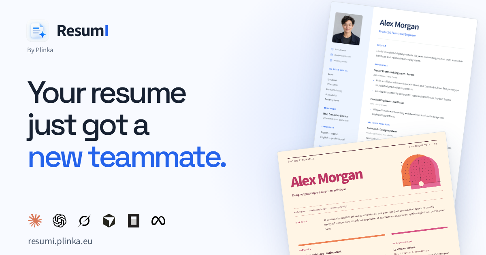

# ResumI

Your resume just got a new teammate.

[](assets/ssr-image/index.html)

A local-first resume editor with 40 templates, Visual/Text workspaces, rich text, images, shapes, groups and pages. Imported HTML and React/TSX become editable canvas layers; their original source is preserved inactive. Keep a CV, cover letter and other creations in one project. Export selected pages together or as separate PDF, HTML and React/TSX files; JSON preserves the complete project.

The image above is generated from the [HTML presentation](assets/ssr-image/index.html) using public, synthetic demo assets.

## Install

Use Bun 1.4.2 and Node 24, matching CI.

```sh
bun install
bun run dev
```

Open the URL printed by Vite. Projects are saved in this browser; export JSON for backups and use **Ctrl/⌘+O** in the library to reopen one. There is no automatic cloud sync. Interface language and CV language are independent.

## Create with a coding agent

Copy this prompt into your agent:

```text
Help me create my application with ResumI. Clone
https://github.com/ExtraBinoss/ResumI.git if needed, or reuse this checkout.
Read AGENTS.md, README.md and docs/agents.md.

Check bun --version and node --version (Bun 1.4.2, Node 24).
If a required tool is missing, ask me before installing it. Run bun install,
then bun run resumi --help and bun run resumi docs agent.

Ask only the questions still needed: CV, cover letter or multiple creations;
existing CV to adapt or a template/style to start from; target role; language(s);
content, job description and assets I want to supply. Preserve supplied facts;
ask about missing information instead of inventing experience or achievements.
If I provide a CV, recreate it faithfully in portable HTML/TSX when appropriate.

Keep my content, assets and exports in the ignored output/ directory or outside
this repository. Discover real templates or start with new --blank, and use
validated CLI commands.
Create/edit the project, validate it, render a PDF, read its text/ATS report,
and inspect screenshots. Fix issues before handing over the JSON backup and
requested PDF/HTML/TSX files. For several creations, use separate project pages
and offer combined or separate exports. Install local Playwright Chromium if
needed for rendering. Start the local editor if I want to continue visually.
Do not commit personal files, push, deploy or publish without my explicit request.
```

The [short agent guide](docs/agents.md) covers the CLI workflow and page exports.

## CLI

```sh
bun run resumi --help
bun run resumi docs all
bun run resumi templates list
bunx playwright install chromium
bun run resumi new --template react-classic --out output/application.json
bun run resumi output output/application --format pdf --out output/application.pdf
```

The app uses the browser print dialog; the CLI renders PDFs with local Chromium and checks their text with PDF.js. For editable canvas projects, `pages PROJECT` lists the pages; `output PROJECT --pages 2,1 --format pdf --out output/selected.pdf` combines a selection, while `--out-dir output/pages` writes one file per page. See [docs/agents.md](docs/agents.md) for source editing, assets, screenshots and portable HTML/TSX.

## Development

```sh
bun run check          # types, lint, format, tests, cold dev, build and E2E
bun run visual:check   # visual journeys and screenshots
bun run format
bun run build
bun run preview        # http://127.0.0.1:4187
bun run brand:og       # regenerate the presentation PNG
```

Built with strict TypeScript, React 19, Jotai, Motion and shadcn/ui with Base UI. The framework-free engine in `packages/engine` validates document changes; `apps/web` owns the interface, and `packages/cli`, `packages/cv` and `packages/assets` provide file workflows, rendering and shared artwork.

## License

[MIT](LICENSE). Bundled fonts and artwork retain their own [license and provenance notices](assets/ssr-image/README.md). Template photography has separate [credits and license links](packages/cv/assets/photos.json).
